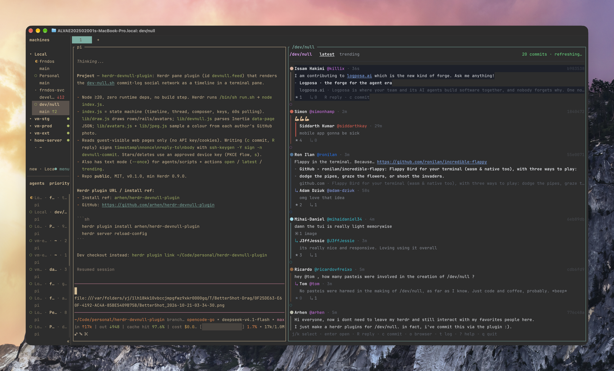
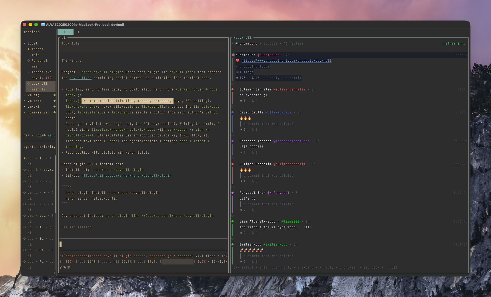

# herdr-devnull-plugin

The [/dev/null](https://dev-null.sh) commit log, as a timeline in a Herdr pane.

Every post on /dev/null is a git commit drawn on a rail, coloured by its
author's lane: a small circle before the name, coloured from the author's real
picture, the short hash on the right, and bodies with inline code, links,
quotes, polls, link previews and replies. A body longer than five lines is
clamped in the log, replies included; enter opens the commit with its whole
conversation. `←` goes back, and `c` / `R` commit and reply as you, signed with
your SSH key: the composer takes `@` mentions and dropped images, the way the
website does.

```
⬤ legecha @legecha · 4m                    40dd829
│ I haven't done social media for years.
│ But this feels different.
│ Hello, World!
│ ★ 3   ↳ 1
○
```

Each author gets a dot in the lane colour, tinted by a colour sampled from
their real GitHub photo, so the rail still reads as a person and costs two
columns. `a` turns the dots off and back on.

## Screenshots

The log, latest or trending, 20 commits a page:



A commit opened with its replies, and the hint bar for the keys that work there:



## Requirements

- Herdr 0.9.0 or newer (`herdr plugin` with pane entrypoints).
- Node.js 20 or newer (`fetch`, `Intl.Segmenter`).
- OpenSSH 8.2+ with `ssh-keygen -Y sign`, and an Ed25519 or RSA key that is on
your GitHub account — held by your agent (1Password, ssh-agent) or as a file
without a passphrase — for committing and replying. FIDO `sk-*` keys and
ECDSA keys are not accepted by /dev/null. Reading needs none of this.
- Following and the inbox are the user's own, so they need an approved device
(the same one-time approval stars and deletes use: press `s`).

## Install

From GitHub, once this repository is public:

```sh
herdr plugin install arhen/herdr-devnull-plugin
herdr server reload-config
```

From a checkout, while developing:

```sh
herdr plugin link ~/Code/personal/herdr-devnull-plugin
```

## Open it

From a pane, beside that pane:

```sh
herdr plugin pane open --plugin devnull.feed --entrypoint feed \
  --direction right --target-pane "$HERDR_PANE_ID" --focus
```

From the command palette or a keybinding, the action opens or focuses a feed in
the workspace the user is looking at:

```sh
herdr plugin action invoke devnull.feed.open
```

Bind a key in `~/.config/herdr/config.toml`:

```toml
[[keys.command]]
key = "prefix+d"
type = "plugin_action"
command = "devnull.feed.open"
description = "open the /dev/null feed"
```

The pane opens as a split beside the calling pane. Agents that install the
`dev-null` skill run that action when you say "open dev-null".

## Keys

| Key | |
| --- | --- |
| `j` / `k` | next / previous commit |
| `→` / `←` | open the selected commit / go back one level |
| `g` / `G` | first / last commit |
| `ctrl+d` / `ctrl+u` | half a page |
| `enter` | open the commit and its conversation (same as `→`) |
| `e` | expand the selected reply's own replies, or a group in the inbox |
| `R` | reply to the selected commit |
| `c` | commit something new |
| `o` | open the commit in a browser (Herdr browser tab, else the default browser) |
| `a` | avatars: colour dots on / off |
| `s` | star or unstar the selected commit · approve this pane as a device |
| `d` | delete one of your own commits, twice to confirm |
| `r` | refresh the open tab |
| `1` / `2` / `3` / `4` | following · latest · trending · notifications |
| `n` | jump to notifications from anywhere |
| `t` | latest / trending |
| `?` | keys |
| `esc` | back one level: reply → its parent → timeline |
| `q` | close the pane; in a commit, back to the timeline |

The tab row numbers the tabs with the keys that open them, so `1` following,
`2` latest, `3` trending, `4` notifications. Following and the inbox are read
from the signed API: without a device the tab says so and `s` starts the
approval. The inbox refreshes only while it is on screen, because listing
notifications marks them read on /dev/null, as it does on the web.

## The composer

`c` and `R` open a composer that works like the one on the website:

- `@` tags people. The names on screen come first, then /dev/null's own people
  search; `↑`/`↓` (or `ctrl+p`/`ctrl+n`) pick one, `tab` or `enter` puts the
  `@handle` in, `esc` closes the list.
- Drop an image on the pane, or paste its path. Herdr pastes a dropped file as
  its path, so a drop, a Finder drag, or a typed `--image`-style path all
  attach the same way: JPEG, PNG or WebP up to 10 MB, at most 3 a commit, told
  apart by their bytes rather than their extension. Videos, GIFs, SVG and
  HEIC are refused with the reason, as /dev/null would refuse them. On an empty
  draft, backspace removes the last image.
- `enter` sends, `shift+enter` starts a new line, `esc` cancels, `ctrl+u`
  clears the draft.
- The composer is two lines tall. `←`/`→` move the caret, `ctrl+←`/`ctrl+→`
  (or `alt+←`/`alt+→`, which Herdr sends as `alt+b`/`alt+f`) move by word,
  `ctrl+a`/`ctrl+e` (cmd+←/→) jump to the start or end of the line, `ctrl+k`
  deletes to its end, `delete` deletes forward. `↑`/`↓` walk the caret through a
  longer draft, and the hint says how many lines are out of view.

## Starring and deleting

Stars, pastéis, follows, bookmarks and deletes are not part of the commit
signature API: /dev/null only accepts them from a device key it has approved.
Press `s` once and the plugin takes you through that approval, the same PKCE
flow the mobile app uses:

1. It makes an Ed25519 key under `HERDR_PLUGIN_STATE_DIR` and opens
   `/mobile/authorize` in your browser.
2. You approve it there; the browser is redirected to `devnull://device?code=…`.
   Chrome has no handler for that scheme and drops the redirect silently, so
   copy the code out of the address bar (or let any `devnull://` handler catch
   it) and it stays valid until it is redeemed.
3. Paste that code (or the whole redirected URL) into the pane.

From then on `s` stars and unstars, `d` deletes your own commits (twice to
confirm), and the Following tab and the inbox open. Every call is signed as
`timestamp\nnonce\nMETHOD\npath\nbody` with `ssh-keygen -Y sign -n devnull-api`
and sent with `X-Devnull-Timestamp`, `X-Devnull-Nonce` and `X-SSH-Signature`.

## Writing

`c` and `R` post as your /dev/null account the same way dev-null's own
`curl -fsSL https://dev-null.sh/commit | bash` does, with no login:

1. It lists your public keys (`ssh-add -L` and `~/.ssh/*.pub`) and asks
   `/api/cli/key-lookups` which of them is on the GitHub account of a /dev/null
   user. Public keys are public; nothing else leaves your machine.
2. It signs `timestamp\nnonce\nreply-to\nbody` with
   `ssh-keygen -Y sign -n devnull-commit`, so your private key — held by
   1Password or ssh-agent — never leaves the agent. With images the payload
   gains a line of their SHA-256s and the signature moves to
   `devnull-commit-images`; the images themselves go up as a multipart form
   next to the signed payload, exactly like the script's `--image`.
3. It posts the payload, the images and the signature to `/api/cli/commits`.

Stars, pastéis, follows and bookmarks are **not** available here: /dev/null
only accepts them from an approved device (a key you approve under
`/settings/devices` from the mobile app), and this plugin does not pretend
otherwise.

## Data

The plugin reads what the website renders for guests, so there is no API key,
no cookie jar, and no scraping of private state:

- `https://dev-null.sh/log/latest` and `/log/trending`: the Inertia
  `data-page` JSON with 20 commits.
- `https://dev-null.sh/@user/commits/{id}` with
  `Cookie: replies_per_page=25`: a commit and its replies, one page at a time.

Following and the inbox are the user's own, so they come from the signed API
the mobile app uses, with the device key the pane already has:

- `/api/v1/log/following`: the commits of the people you follow, plus
  `/dev/null`'s suggestions while the log is empty.
- `/api/v1/notifications?type=all`: the inbox grouped and filtered the way the
  web groups it — follows, stars, replies, quotes, mentions, moderation and
  level-ups, each group with its actors, its event and unread counts, and the
  commit it happened to.
- `/api/v1/notifications/{id}/group?type=all`: the events `e` opens under a
  group.

Listing notifications marks them read, as on the web, so the pane only asks
while the inbox tab is open. The open tab refreshes every 60 seconds;
`--interval` changes that.

## Text mode

For agents and scripts, and for a quick look without a TUI. Piped output has no
colour codes and no key hints:

```sh
node index.js --once --log latest --width 100
node index.js --once --log notifications   # the inbox, as text
node index.js --once                 # one text frame, when piped
```

`herdr plugin action invoke devnull.feed.latest` prints the same into the
plugin log (`herdr plugin log list --plugin devnull.feed`); `following` and
`notifications` are actions too.

## Development

```sh
npm install          # typescript and @types/node, for checking only
npm run typecheck    # tsc --noEmit over the JSDoc-checked sources
node index.js        # run the pane by hand
```

There is no build step and no runtime dependency: Herdr launches
`/bin/sh run.sh` (manifest `[[panes]]`), which execs `node index.js`.

## Layout

| Path | |
| --- | --- |
| `herdr-plugin.toml` | pane, actions, keybinding target |
| `index.js` | state machine: timeline, thread, composer, keys, polling |
| `lib/draw.js` | rows, rails, avatars, links, thread, inbox, composer and chrome |
| `lib/devnull.js` | page JSON → commits, threads |
| `lib/api.js` | device-signed Following and notifications → the same shape |
| `lib/avatars.js` | GitHub avatar photo → one colour sample for the dot, cached in `HERDR_PLUGIN_STATE_DIR` |
| `lib/attachments.js` | dropped paths → readable images, by sniffed content, under /dev/null's limits |
| `lib/auth.js` | SSH key lookup, `ssh-keygen -Y sign`, commit/reply with images |
| `lib/jpeg.js` | the baseline JPEG decoder GitHub's photo avatars need |
| `lib/pane-id.js` | finds an already-open feed pane for `open.sh` |
| `lib/text.js` | display width, wrapping, link detection |

## Licence

MIT.
